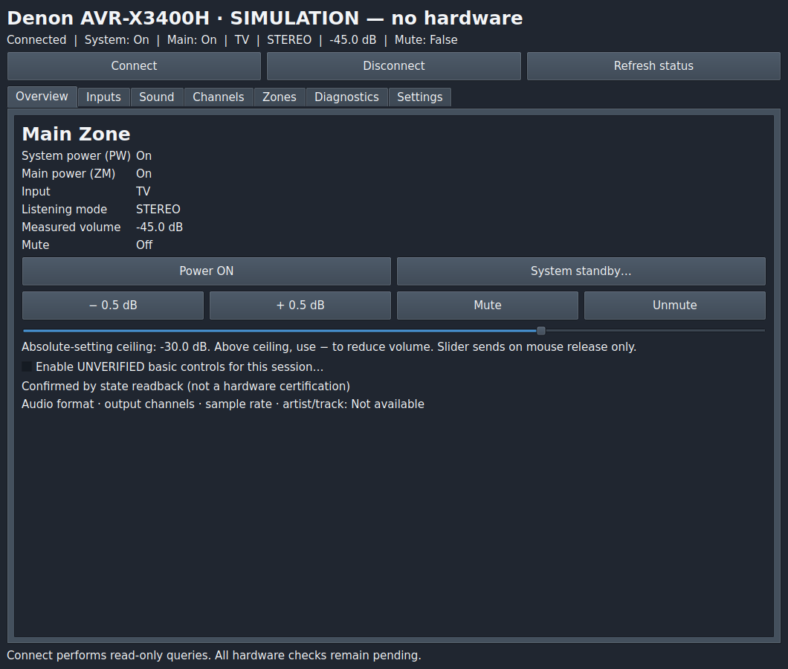

# Denon AVR Controller

A native Python/Qt Widgets desktop controller for the Denon AVR-X3400H on a
private home LAN. Linux first; no browser front-end, cloud account, HMS
dependency, phone interception, or startup write commands.

**Hardware status:** only HTTP `PWON` on port 8080 is owner-verified.
This project has not been tested against a physical AVR in development.
All automated fixtures are synthetic. Readback is required for confirmation;
HTTP 200 alone is never shown as success.

## Install (Ubuntu, Python 3.12+)

Use the existing repository root (`denon_AVR_modern_gui`); the installable project
is named `denon-avr-controller`. There is deliberately no nested repository.
Check your installed Python version first.

```bash
sudo apt update
sudo apt install -y python3 python3-venv python3-pip git
# From your checkout's absolute path:
python3 -m venv .venv
source .venv/bin/activate
python -m pip install -e '.[dev]'
python -m denon_controller --simulate
```

For Qt's native X11/xcb platform on Ubuntu, if missing:

```bash
sudo apt install -y libegl1 libgl1 libxkbcommon0 libxkbcommon-x11-0 \
  libxcb-cursor0 libxcb-icccm4 libxcb-image0 libxcb-keysyms1 \
  libxcb-render-util0 libxcb-xinerama0 libxcb-xkb1 libxcb-shape0
```

Do **not** run the GUI as root. On a headless test runner use
`QT_QPA_PLATFORM=offscreen`; that is not needed on a normal desktop.

## Run and connect

```bash
python -m denon_controller                 # or: denon-controller
python -m denon_controller --simulate      # synthetic state, no network traffic
bash scripts/run_linux.sh                 # uses the checkout's .venv
```

1. In **Settings**, enter the receiver's private LAN hostname/IP (not a URL).
   HTTP defaults to **8080**, TCP/Telnet to **23**. Save while disconnected.
   The test-time address from the briefing is intentionally not a default.
2. Click **Connect**. Startup/connect only sends fixed read-only status queries.
   TCP events are preferred; if unavailable, candidate HTTP XML endpoints are
   polled. A reachable endpoint without recognized state still shows Offline.
3. Click **Power ON** deliberately. The known command is sent once. The result
   stays pending or indeterminate unless a subsequent status readback matches.
4. Basic volume/mute/input/standby writes are **unverified candidates**. They
   require explicit per-session opt-in and fresh relevant readback. Input
   selection also requires a reported source list. System standby is guarded.
   The initial absolute-volume ceiling is **−30 dB**; reducing volume and muting
   are not blocked by that ceiling. Volume is encoded as Denon half-steps,
   not raw UI dB. No writes are automatically retried.
5. **Sound**, **Channels** and **Zones** explain unavailable/untested functions.
   No calibration, EQ, Audyssey, speaker setup or Zone 2 writes are implemented.

Settings live in `$XDG_CONFIG_HOME/denon-controller/config.toml` (default
`~/.config/denon-controller/config.toml`), or
`%APPDATA%\denon-controller\config.toml` on Windows. See
[config.example.toml](config.example.toml). `--config /absolute/path/config.toml`
overrides the read location; GUI Save writes the standard per-user location.
Unverified-control opt-in is never persisted. Discovery is off by default and,
when enabled, requires a separate explicit button click. It does not certify
identity or choose an HTTP control port from a UPnP descriptor.

### Safe diagnostic CLI (no GUI required)

```bash
python -m denon_controller --diagnose --host receiver.local
python -m denon_controller --diagnose --host receiver.local --telnet
python -m denon_controller --diagnose --simulate --output /tmp/diagnostic-demo.json
# Only when intentionally ready to turn the receiver on:
python -m denon_controller --diagnose --host receiver.local --power-on
python scripts/diagnose_avr.py --host receiver.local
python scripts/export_capabilities.py
```

Exit 0 means recognized readback (and a matching power readback if requested);
exit 2 means offline/unrecognized/unconfirmed or invalid arguments. A single
immediate diagnostic read may precede the receiver finishing its wake-up:
run another **read-only** probe, not another power command.
Exports contain bounded sanitized events, not raw network responses or captures.
Review them manually before sharing. Neither GUI nor CLI scans ports/subnets.

## UI preview



## Development and validation

```bash
python -m pytest
ruff check .
ruff format --check .
python -m build --outdir /tmp/denon-build
QT_QPA_PLATFORM=offscreen python -m pytest tests/test_gui.py
```

Tests block outbound network/DNS and use mocked HTTP, socket-pair TCP, and the
synthetic simulator. Coverage includes state parsing, separate PW/ZM/Zone 2,
volume mapping/ceilings, unconfirmed writes, rate limiting, offline recovery,
sanitization, settings, and Qt startup/shutdown. No AVR or internet is required
to run tests after dependencies are installed.

The network service runs in a dedicated Qt thread; signals deliver copied
snapshots to widgets. Fixed endpoint/command allowlists, bounded reads,
private-address pinning, serialized writes and timeout/backoff protect the
desktop session. No UI widget constructs protocol strings.

## Scope and next safe hardware test

Start with `--diagnose` **without** `--power-on`, record receiver firmware and
which read-only endpoints return recognized data, then test physical-remote
changes. Only afterward try the known Power ON command deliberately at low
volume. Never infer that another command is validated from synthetic tests.

See [protocol/evidence ledger](docs/protocol.md),
[capability matrix](docs/capabilities.md),
[troubleshooting and owner QA](docs/troubleshooting.md),
[handoff](HANDOFF.md) and [milestones](TODO.md).

Windows launch is provided (`powershell -File scripts/run_windows.ps1`) after
creating `.venv` with Python 3.12+ and installing the same dev extra. Windows,
real Ubuntu desktop/4K scaling, live firmware responses and advanced functions
still need owner QA. MIT licensed; no Denon app artwork, assets or branding
are copied. `denonavr` was evaluated as a reference (MIT); it is not vendored
or required. This small transport implementation preserves explicit evidence
gating instead of treating library model-family support as hardware validation.